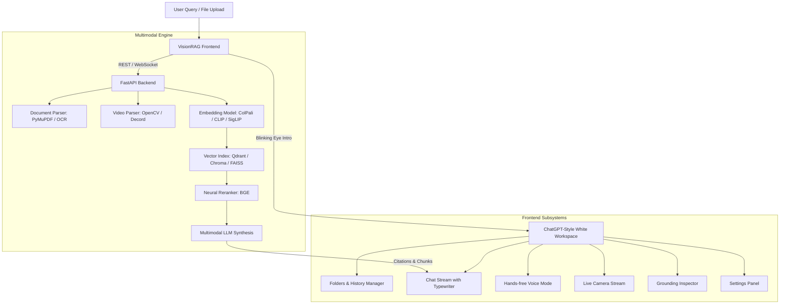

https://github.com/user-attachments/assets/8535e908-c836-4800-bf03-08896b49b57e


# VisionRAG - Multimodal Retrieval-Augmented Generation

[](.github/workflows/lint.yml)
[](.github/workflows/tests.yml)
[](https://www.python.org/)
[](https://nodejs.org/)
[](LICENSE)

**VisionRAG** is an advanced, production-grade Multimodal Retrieval-Augmented Generation (RAG) platform designed to ingest, ground, and synthesize answers across complex visual assets: technical diagrams, multi-column scientific PDFs, high-resolution imagery, and temporal video streams.

---

## Key Highlights & Features

### 1. Futuristic Intro Splash Animation
- **"O" Letter with Intelligent Eye:** Startup animation featuring a sleek outer "O" letter ring with an inner iris and pupil.
- **Blink In & Blink Out Dynamics:** Smooth saccade movement, scanner line, pupil dilation, and natural eyelid blink transitions into the web app.
- **Replay Capability:** Replay the intro anytime via the brand logo or General Settings.

### 2. ChatGPT-Style Clean White Aesthetic
- **Minimalist Design System:** Pure white surface (`#FFFFFF`), light neutral sidebar (`#F9FAFB`), subtle borders (`#ECECF1`), and refined typography using Google Inter.
- **Centered Chat Stream:** Message bubbles with user attachments, markdown formatting, syntax-highlighted code blocks with copy buttons, and typewriter streaming effect.

### 3. Folder Hierarchy & Chat Organization
- **User-Created Folders:** Create, rename, and delete custom project folders (e.g., *Research & Documents*, *Financial & Reports*, *Video Intelligence*), mirroring modern ChatGPT workspaces.
- **Chat Management:** Organize conversations into folders, search chat history, pin critical chats, rename, and delete sessions.
- **Date Grouping:** Automated classification into *Today*, *Yesterday*, *Previous 7 Days*, and *Older*.

### 4. Multimodal Uploads & Visual Grounding
- **Multimodal Support:** Native drag-and-drop ingestion for PDFs, images (PNG, JPG, TIFF), videos (MP4, WebM), audio recordings, and text files.
- **Upload Tray:** Real-time upload progress bars, file type detection chips, and preview badges.    v
- **Grounding Inspector:** Interactive citation pills (e.g., `[power_schematic_v2.pdf (p. 3) - 96% Match]`) that open an inspector displaying the exact text chunk, confidence score, and visual bounding box coordinate mapping.

### 5. Interactive Voice Mode & Live Camera
- **Hands-Free Voice Chat:** Fullscreen overlay with a pulsing, fluid 3D glowing voice orb that listens, transcribes in real-time, and speaks back assistant responses using natural speech synthesis.
- **Live Camera / Video Stream Mode:** Live camera feed integration (`getUserMedia`) with simulated ColPali target bounding box overlays and one-click frame capture for direct RAG visual inquiry.

### 6. Comprehensive Settings Panel
- **General:** Theme options, typewriter speed tuning, replay intro splash.
- **RAG & Retrieval:** Top-K retrieved chunks (1–10), similarity threshold (0.50–0.95), and neural reranker toggles.
- **Vision & Multimodal:** Selection between ColPali v1.2 multi-vector, CLIP ViT-L/14, and SigLIP SO400M, OCR engines (EasyOCR, Tesseract, PaddleOCR), and video frame extraction rates.
- **Voice & Audio:** Speech rate, pitch, and automated speech readout toggles.
- **Backend API:** FastAPI URL configuration with intelligent fallback simulation.
- **Data:** Export conversations to JSON or reset local storage.

---

## System Architecture



---

## Directory Structure

```
VisionRAG/
├── .github/
│   └── workflows/
│       ├── lint.yml             # Python & Frontend linting workflow
│       └── tests.yml            # Automated matrix tests & build check
├── backend/
│   └── requirements.txt         # Core backend ML & RAG dependencies
├── frontend/
│   ├── public/
│   ├── src/
│   │   ├── components/
│   │   │   ├── ChatArea.js      # Main chat area & input pill
│   │   │   ├── IntroSplash.js   # O letter & blinking eye animation
│   │   │   ├── Sidebar.js       # Folders & date-grouped history
│   │   │   ├── SettingsModal.js # Tabbed settings configuration
│   │   │   ├── SourceModal.js   # Grounding & bounding box inspector
│   │   │   ├── VideoModal.js    # Live webcam & video analysis
│   │   │   └── VoiceModal.js    # Hands-free fluid voice orb mode
│   │   ├── services/
│   │   │   └── api.js           # FastAPI client & neural simulation engine
│   │   ├── store/
│   │   │   └── state.js         # Reactive state & localStorage sync
│   │   ├── styles/
│   │   │   └── main.css         # Modern white ChatGPT design system
│   │   └── main.js              # Application entrypoint
│   ├── index.html               # Main HTML shell
│   ├── package.json             # Vite scripts & frontend dependencies
│   └── vite.config.js           # Dev server & API proxy
├── requirements-dev.txt         # Developer linting, formatting & test tools
└── README.md                    # Project documentation
```

---

## Getting Started

### 1. Frontend Setup & Launch

The frontend is built with vanilla modern JavaScript and bundled with Vite for fast HMR.

```bash
cd frontend
npm install
npm run dev
```

The application will launch at `http://localhost:3000/`.

To build the production bundle:
```bash
npm run build
npm run preview
```

### 2. Backend Environment Setup

Install backend Python dependencies:
```bash
cd backend
python -m venv venv
# Windows:
venv\Scripts\activate
# Linux/macOS:
source venv/bin/activate

pip install -r requirements.txt
pip install -r ../requirements-dev.txt
```

---

## CI/CD Workflows

Continuous Integration is configured with GitHub Actions:

- **`.github/workflows/lint.yml`**:
  - Backend: Black code formatting, Ruff linting, Flake8 syntax checks, and Mypy static typing.
  - Frontend: Dependency verification and build checks.
- **`.github/workflows/tests.yml`**:
  - Multi-version Python test runner (Python 3.10 and 3.11).
  - Frontend production build verification on Node.js 20.

---

## License

This project is licensed under the MIT License. See [LICENSE](LICENSE) for details.
